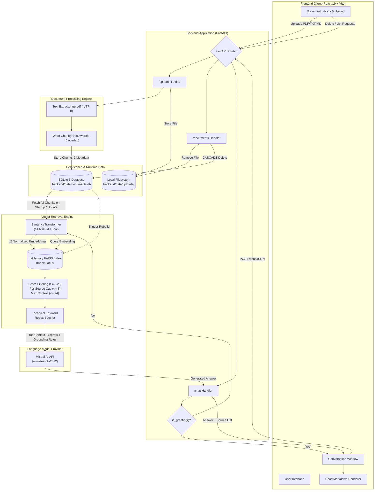
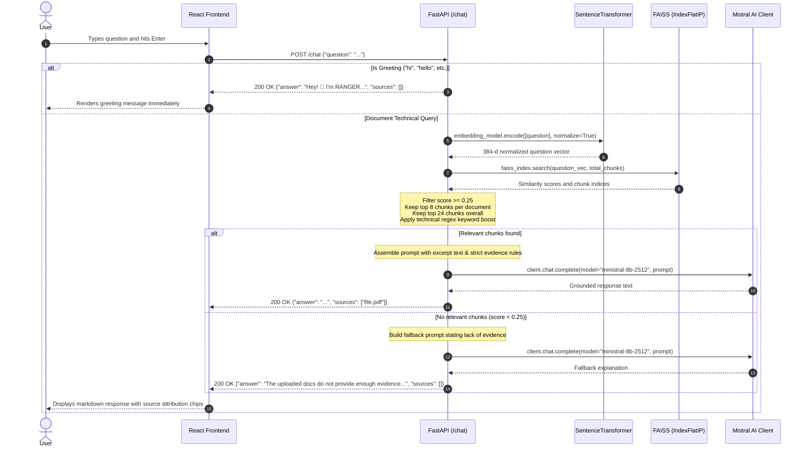

# RANGER — AI Documentation Assistant

*An AI-powered documentation assistant for querying technical documents using retrieval-augmented generation.*

[](https://www.python.org/)
[](https://fastapi.tiangolo.com/)
[](https://react.dev/)
[](https://vitejs.dev/)
[](https://mistral.ai/)
[](https://github.com/facebookresearch/faiss)
[](https://huggingface.co/sentence-transformers/all-MiniLM-L6-v2)
[](https://www.sqlite.org/)

---

## Recruiter & Engineering Summary

**RANGER** is a full-stack Retrieval-Augmented Generation (RAG) system built to solve developer friction when searching dense technical documentation, API specifications, and architecture guides. Unlike naive LLM chat wrappers that hallucinate facts or suffer from context overflow, RANGER couples a high-throughput vector retrieval pipeline with defensive system prompt engineering:

- **Strict Source Grounding:** Powered by Mistral AI (`ministral-8b-2512`) with rigorous negative-constraint prompting that enforces zero external speculation, refuses to invent undocumented endpoints, and explicitly reports insufficient evidence.
- **Hybrid Retrieval Strategy:** Combines 384-dimensional dense semantic vector search via Facebook AI Similarity Search (`FAISS` using inner-product cosine similarity over normalized embeddings) with a domain-specific technical keyword heuristic to capture exact API routes, HTTP verbs, and query tokens.
- **Fair-Share Context Allocation:** Implements document-level chunk clamping (`MAX_CHUNKS_PER_SOURCE = 8`, `MAX_CONTEXT_CHUNKS = 24`) with cosine similarity threshold filtering (`0.25`) to prevent single-document monopolization of the LLM context window.
- **Relational Persistence & Zero-Downtime Re-indexing:** Retains full document text and chunked metadata in an ACID-compliant SQLite relational database (`ON DELETE CASCADE`), enabling dynamic in-memory vector index rebuilding on startup, file upload, or deletion without requiring persistent external vector database infrastructure.
- **Production-Grade Developer UI:** Built with React 19 and Vite, featuring real-time document library management, instant greeting bypass, interactive technical prompt suggestions, markdown syntax rendering with code formatting, and source document attribution chips.

---

## Table of Contents

- [Project Overview](#project-overview)
  - [The Problem](#the-problem)
  - [The Solution](#the-solution)
  - [Target Users](#target-users)
  - [System Capabilities & Boundaries](#system-capabilities--boundaries)
- [Key Features](#key-features)
- [System Architecture](#system-architecture)
  - [High-Level Architecture](#high-level-architecture)
  - [Query Execution Sequence](#query-execution-sequence)
- [End-to-End Workflows](#end-to-end-workflows)
  - [1. Document Ingestion Pipeline](#1-document-ingestion-pipeline)
  - [2. Question-Answering & Retrieval Pipeline](#2-question-answering--retrieval-pipeline)
  - [Retrieval Architecture & Known Constraints](#retrieval-architecture--known-constraints)
- [Technology Stack](#technology-stack)
  - [Component Responsibility Matrix](#component-responsibility-matrix)
  - [Architectural Roles Explained](#architectural-roles-explained)
- [Repository Structure](#repository-structure)
- [Prerequisites](#prerequisites)
- [Installation and Local Setup](#installation-and-local-setup)
  - [Step 1: Clone Repository](#step-1-clone-repository)
  - [Step 2: Backend Setup (FastAPI & Python)](#step-2-backend-setup-fastapi--python)
  - [Step 3: Frontend Setup (React & Vite)](#step-3-frontend-setup-react--vite)
  - [Step 4: Verification & API Documentation](#step-4-verification--api-documentation)
- [Configuration](#configuration)
  - [Environment Variables](#environment-variables)
  - [Application Constants](#application-constants)
- [API Reference](#api-reference)
  - [1. Root Health Check](#1-root-health-check)
  - [2. Upload & Ingest Document](#2-upload--ingest-document)
  - [3. List Indexed Documents](#3-list-indexed-documents)
  - [4. Delete Document](#4-delete-document)
  - [5. Submit Question (RAG Chat)](#5-submit-question-rag-chat)
- [Example Usage Walkthrough](#example-usage-walkthrough)
- [Retrieval & AI Design Decisions](#retrieval--ai-design-decisions)
- [Testing & Evaluation](#testing--evaluation)
- [Security and Privacy](#security-and-privacy)
- [Limitations and Planned Improvements](#limitations-and-planned-improvements)
- [Performance & Benchmarking Plan](#performance--benchmarking-plan)
- [Screenshots & UI Preview](#screenshots--ui-preview)
- [Troubleshooting](#troubleshooting)
- [Engineering Highlights & Resume Relevance](#engineering-highlights--resume-relevance)
- [Contributing & License](#contributing--license)
- [Author Information](#author-information)

---

## Project Overview

### The Problem

Technical documentation for complex protocols (e.g., OData, OpenAPI, cloud SDKs, enterprise frameworks) frequently exceeds hundreds of pages. Developers encounter major productivity bottlenecks:
1. **Manual Keyword Fragility:** Traditional text search (`Ctrl + F`) requires knowing the exact naming conventions and fails on conceptual questions (e.g., asking *"How do batch operations work?"* when the document discusses *"Changeset execution boundaries"*).
2. **Context Window Limitations:** Raw documents cannot simply be pasted into an LLM prompt without hitting token caps, incurring exorbitant latency, and escalating API costs.
3. **Hallucination Risk:** Public LLMs often invent plausible-sounding endpoints, parameters, or deprecated syntax when answering domain-specific technical questions.

### The Solution

**RANGER** bridges raw documentation files and conversational AI by implementing a local Retrieval-Augmented Generation pipeline. It indexes technical files locally, retrieves only the highest-scoring relevant excerpts using vector similarity search, and injects those excerpts into a strictly constrained LLM prompt. Every factual claim is anchored to uploaded source text, accompanied by source attribution chips.

### Target Users

- **Software Engineers & API Integrators:** Quickly discover endpoints, payload structures, query parameters, and error codes from protocol specifications.
- **Technical Writers & Architects:** Validate document clarity, cross-reference multiple specs, and identify documentation coverage gaps.
- **DevOps & Platform Teams:** Query internal runbooks, infrastructure guides, and deployment checklists.

### System Capabilities & Boundaries

| Capability | Supported in Current Implementation | Notes / Operational Boundaries |
| :--- | :---: | :--- |
| **PDF Ingestion** | Yes | Extracted page-by-page using `pypdf.PdfReader`. Text must be selectable (no OCR for scanned bitmaps). |
| **Markdown & TXT Ingestion** | Yes | Decoded using `utf-8-sig` with Unicode replacement error handling. |
| **Word-Window Chunking** | Yes | 180 words per chunk with 40-word sliding window overlap. |
| **Dense Vector Retrieval** | Yes | Embeddings generated by `all-MiniLM-L6-v2` (384 dims, L2 normalized). |
| **Cosine Similarity Search** | Yes | FAISS `IndexFlatIP` on normalized vectors. |
| **Similarity Thresholding** | Yes | Chunks with cosine similarity $< 0.25$ are discarded. |
| **Source Fairness Clamping** | Yes | Max 8 chunks per document, max 24 chunks total across all documents. |
| **Technical Keyword Boost** | Yes | Regex supplement captures exact API tokens (`GET`, `POST`, `endpoint`, etc.). |
| **Document Deletion** | Yes | Cascades across SQLite, deletes physical file, and rebuilds FAISS index. |
| **Deterministic Greetings** | Yes | Bypasses vector search and LLM for common greetings (`hi`, `hello`, `hey`). |
| **Source Attribution** | Yes | Returns unique source filenames displayed as clickable/visible chips. |
| **Page-Level Citations** | No (Planned) | Chunks currently track parent `filename` and `chunk_index`, but not PDF page numbers. |
| **Multi-Tenancy / User Auth** | No (Planned) | Single-user local workspace; documents are globally accessible to the running instance. |
| **Asynchronous Background Indexing** | No (Planned) | Small-to-medium files are indexed synchronously during the `/upload` request. |

---

## Key Features

- **Multi-Format Document Parsing:** Ingests `.pdf`, `.txt`, and `.md` files up to 10 MB directly into the workspace. *(Benefit: Allows engineers to upload official PDF specs and local Markdown notes side by side.)*
- **Overlapping Word-Window Chunking:** Slices extracted document text into 180-word windows with a 40-word sliding overlap. *(Benefit: Preserves vital contextual continuity across chunk boundaries so definitions and code examples remain intact.)*
- **Local Dense Embeddings:** Generates 384-dimensional vector embeddings using Hugging Face's `sentence-transformers/all-MiniLM-L6-v2` model locally on CPU or GPU. *(Benefit: Zero external embedding API cost or latency during document processing.)*
- **In-Memory FAISS Vector Indexing:** Utilizes `faiss.IndexFlatIP` to perform exact inner-product similarity search over normalized vectors. *(Benefit: Delivers sub-millisecond similarity retrieval across thousands of document chunks.)*
- **Relevance Score Gating:** Enforces a strict cosine similarity cutoff (`SIMILARITY_THRESHOLD = 0.25`). *(Benefit: Prevents ungrounded noise from polluting the context window when a question is outside the document corpus.)*
- **Balanced Multi-Document Retrieval:** Limits retrieved chunks to a maximum of 8 per document and 24 total. *(Benefit: Guarantees that a single large document cannot crowd out relevant excerpts from complementary specs.)*
- **Technical Keyword Augmentation:** Scans queries for critical technical tokens (`endpoint`, `url`, `get`, `post`, `metadata`, `route`, etc.) and supplements vector search with top matching text passages. *(Benefit: Overcomes semantic search blindspots when looking for exact protocol keywords.)*
- **Mistral LLM Integration:** Employs Mistral AI's `ministral-8b-2512` model via the official `mistralai` SDK for instruction following and structured technical explanations. *(Benefit: Produces concise, developer-friendly answers backed by high-capacity reasoning.)*
- **Defensive Hallucination Guardrails:** System prompt strictly prohibits external knowledge injection, forbids guessing undocumented endpoints, and mandates explicit statements of missing evidence. *(Benefit: Prevents dangerous coding bugs caused by AI-invented APIs or false assumptions.)*
- **ACID Relational Persistence:** Tracks documents and chunk metadata in an SQLite database (`documents.db`) configured with foreign key cascades. *(Benefit: Guarantees that workspace state survives server restarts without manual re-uploading.)*
- **Safe Document Lifecycle:** Deleting a document removes its physical file, cascades SQLite chunk records, and dynamically synchronizes the FAISS index. *(Benefit: Keeps the vector search index clean and free of orphaned references.)*
- **Zero-Latency Greeting Handling:** Intercepts conversational greetings using deterministic regex matching before invoking the retrieval or LLM pipeline. *(Benefit: Saves LLM tokens and provides instantaneous UI response for introductory messages.)*
- **Responsive Dark-Theme UI:** React 19 interface styled with a custom dark palette (`#080d18`), custom typography (DM Sans and Space Grotesk), real-time status indicators, and keyboard shortcuts (`Enter` to submit, `Shift+Enter` for multiline). *(Benefit: Delivers an uncluttered, modern terminal-like experience optimized for developers.)*
- **Markdown & Code Rendering:** Formats assistant responses with `react-markdown` to render headers, tables, bullet points, and code blocks cleanly. *(Benefit: Makes complex technical explanations immediately readable.)*
- **Pre-Configured Suggestion Prompts:** Displays 4 one-click starter cards (Summarize, Explain, Compare, Technical Details) on blank conversations. *(Benefit: Lowers cognitive load for first-time users exploring new documentation.)*

---

## System Architecture

### High-Level Architecture



### Query Execution Sequence



---

## End-to-End Workflows

### 1. Document Ingestion Pipeline

When a user selects a file in the React sidebar, the ingestion pipeline executes synchronously across the frontend, filesystem, database, and vector index:

```
[User Selects File] 
        │
        ▼
[Frontend: POST /upload (multipart/form-data)]
        │
        ▼
[FastAPI Validation]
   ├── File empty check (HTTP 400)
   ├── File size cap <= 10 MB (HTTP 413)
   └── Extension whitelist: .pdf, .txt, .md (HTTP 400)
        │
        ▼
[Text Extraction]
   ├── PDF: pypdf.PdfReader iterates pages, concatenating page.extract_text()
   └── TXT / MD: Decoded from bytes via utf-8-sig (with Unicode error replacement)
        │
        ▼
[Word-Window Chunking]
   └── split_text(): Words partitioned into 180-word blocks with 40-word step overlap
        │
        ▼
[Filesystem & Relational Persistence]
   ├── File bytes written to backend/data/uploads/<filename>
   ├── SQLite Transaction:
   │     ├── DELETE FROM documents WHERE filename = ? (removes existing duplicate)
   │     ├── INSERT INTO documents (filename, stored_path) VALUES (?, ?)
   │     └── INSERT INTO document_chunks (document_id, chunk_index, text) VALUES (?, ?, ?)
   └── Commit transaction (Foreign keys ON; ON DELETE CASCADE handles chunk cleanup)
        │
        ▼
[FAISS Vector Re-indexing]
   ├── Query all chunks across all documents from SQLite (ordered by document and chunk index)
   ├── Encode all chunk texts into 384-dimensional dense vectors using all-MiniLM-L6-v2
   ├── L2-normalize embeddings (numpy float32)
   ├── Initialize faiss.IndexFlatIP(384)
   └── faiss_index.add(embeddings)
        │
        ▼
[HTTP 200 Response]
   └── Returns filename, chunks_added, total_chunks, documents list, and indexed_chunks count
```

### 2. Question-Answering & Retrieval Pipeline

When a user submits a prompt, RANGER executes a multi-stage retrieval and generation lifecycle:

1. **Client Submission:** The React client validates input non-emptiness and dispatches a JSON `POST` request to `/chat` with `{ "question": "..." }`.
2. **Deterministic Greeting Interception:** The backend checks the normalized query against common conversational greetings (`hi`, `hello`, `hey`, `hai`, `good morning`, etc.). If matched, it returns a static greeting without triggering embeddings or LLM inference.
3. **Question Vectorization:** The query text is encoded using `all-MiniLM-L6-v2` with `normalize_embeddings=True`, yielding a unit-length 384-dimensional vector.
4. **FAISS Exhaustive Search:** The vector is searched against `faiss_index` using inner product (which equals cosine similarity for normalized vectors).
5. **Relevance Thresholding & Clamping:**
   - Any chunk with a similarity score below `SIMILARITY_THRESHOLD = 0.25` is immediately discarded.
   - Remaining chunks are grouped by source document and sorted by descending score.
   - To prevent a single large document from overwhelming the prompt, only the top `MAX_CHUNKS_PER_SOURCE = 8` chunks are retained per source.
   - The surviving chunks are merged and capped at `MAX_CONTEXT_CHUNKS = 24`.
6. **Technical Keyword Heuristic Supplement:**
   - The query is inspected via regex for explicit API tokens: `\b(?:endpoint|endpoints|url|urls|uri|uris|http|https|get|post|put|patch|delete|service document|metadata|entityset|entity set|api|apis|route|routes)\b`.
   - If technical terms are detected, non-retrieved chunks are scanned for exact string occurrences. Top-scoring chunks by keyword frequency are appended to fill any remaining slots up to the 24-chunk limit.
7. **Prompt Synthesis:**
   - If relevant chunks exist, they are serialized with explicit provenance headers: `Source: <filename>\nExcerpt: <text>`.
   - The user prompt and strict grounding instructions are bundled with the `SYSTEM_PROMPT`.
   - If no chunks pass the threshold, a specialized fallback prompt instructs Mistral to explain that the uploaded documents lack sufficient evidence.
8. **Inference & Grounding:** Mistral's `ministral-8b-2512` generates the completion adhering to evidence boundaries.
9. **UI Rendering:** The backend extracts deduplicated source names via `list(dict.fromkeys(...))` and returns `{ "answer": "...", "sources": [...] }`. React displays the response formatted in Markdown with source tags below the message.

### Retrieval Architecture & Known Constraints

- **In-Memory Index Rebuilding:** FAISS indexes are held in application memory and rebuilt in full upon startup, upload, and deletion. For small-to-medium documentation libraries (< 10,000 chunks), this completes in seconds. For enterprise-scale libraries (> 100,000 chunks), a persistent on-disk vector store (e.g., Chroma, Qdrant, pgvector) with incremental index updates would be preferred.
- **Word-Window vs. Semantic Boundaries:** Chunks are split strictly on 180-word boundaries. While overlapping windows (40 words) prevent abrupt truncation, sentences or tables may occasionally be divided across chunks.
- **Single-Vector Document Representation:** Documents are represented at the chunk level without hierarchical parent-document or document-summary embeddings.

---

## Technology Stack

### Component Responsibility Matrix

| Technology | Category | Version | Role in Project | Implementation Reference |
| :--- | :--- | :---: | :--- | :--- |
| **Python** | Runtime | `3.10+` | Core backend programming language | `backend/app.py`, `backend/storage.py` |
| **FastAPI** | Web Framework | `^0.100` | REST API, request validation, CORS, error handling | `backend/app.py:79` |
| **Uvicorn** | ASGI Server | `standard` | High-performance asynchronous HTTP server | `backend/requirements.txt` |
| **Mistral AI SDK** | LLM Client | `latest` | Orchestrates completions with `ministral-8b-2512` | `backend/app.py:29`, `backend/app.py:704` |
| **Sentence Transformers** | Embeddings | `latest` | Local dense vector embeddings via `all-MiniLM-L6-v2` | `backend/app.py:102` |
| **FAISS (faiss-cpu)** | Vector Index | `latest` | Exact inner product similarity search (`IndexFlatIP`) | `backend/app.py:204` |
| **SQLite 3** | Relational Database | Built-in | Persistent storage for document metadata & chunk texts | `backend/storage.py:12` |
| **PyPDF** | PDF Parser | `latest` | Extracts text from uploaded PDF documents page-by-page | `backend/app.py:155` |
| **NumPy** | Math / Arrays | `latest` | Vector array manipulation and float32 type casting | `backend/app.py:198` |
| **python-dotenv** | Configuration | `latest` | Loads environment variables from local `.env` | `backend/app.py:22` |
| **React** | Frontend UI | `^19.3.1` | Single-page reactive user interface and state management | `frontend/src/App.jsx` |
| **Vite** | Build Tool | `^8.3.4` | Development server, fast HMR, and production bundler | `frontend/vite.config.js` |
| **React Markdown** | Text Renderer | `^10.1.0` | Renders LLM markdown output, headers, and code blocks | `frontend/src/App.jsx:338` |
| **Oxlint** | Linter | `^1.88.0` | High-speed JavaScript/React linting | `frontend/.oxlintrc.json` |

### Architectural Roles Explained

- **LLM vs. Embedding Model:** The embedding model (`all-MiniLM-L6-v2`) converts text strings into mathematical coordinates (dense vectors) to measure semantic similarity. The LLM (`ministral-8b-2512`) generates human-readable natural language completions based on retrieved text passages.
- **Vector Index vs. Relational Database:** FAISS is **not** a database; it is an in-memory vector index that performs fast geometric nearest-neighbor calculations. SQLite is the authoritative persistent database that stores the actual chunk texts and relational file metadata.
- **Frontend vs. Backend:** The React frontend manages user interactions, uploads, and local session chat history. The FastAPI backend manages file processing, vector search, database operations, and external LLM communication.

---

## Repository Structure

```
AI-DOCUMENT-ASSISTANT/
├── .gitignore                      # Git exclusion rules (venv, node_modules, .env, data/)
├── README.md                       # Comprehensive project documentation (this file)
│
├── backend/                        # Backend FastAPI service
│   ├── app.py                      # Main API application, RAG retrieval engine, & Mistral integration
│   ├── main.py                     # Standalone CLI chat prototype (direct Mistral chat without RAG)
│   ├── storage.py                  # SQLite schema definition, connection manager, & table creation
│   ├── requirements.txt            # Python backend dependency manifest
│   ├── .env                        # Local environment variables (MISTRAL_API_KEY) [Not committed]
│   │
│   └── data/                       # Runtime storage directory [Ignored by git]
│       ├── documents.db            # SQLite database file storing documents & chunk records
│       └── uploads/                # Local directory holding raw uploaded documents (.pdf, .txt, .md)
│
└── frontend/                       # Frontend React single-page application
    ├── index.html                  # HTML entry point with metadata and root element
    ├── package.json                # Frontend package manifest and npm script definitions
    ├── package-lock.json           # Deterministic dependency lockfile
    ├── vite.config.js              # Vite bundler and React plugin configuration
    ├── .oxlintrc.json              # Oxlint linter configuration
    ├── README.md                   # Default template documentation
    │
    ├── public/                     # Public static assets
    │   ├── favicon.svg             # Application browser favicon
    │   └── icons.svg               # Application SVG icons
    │
    └── src/                        # React application source code
        ├── main.jsx                # Application entry point rendering <App /> into root DOM
        ├── App.jsx                 # Core UI component: document library, chat state, & API calls
        ├── App.css                 # Master application stylesheet (custom dark theme, typography)
        ├── index.css               # Base CSS resets and HTML body rules
        └── assets/                 # Component assets
            ├── hero.png            # Application graphic asset
            ├── react.svg           # React logo asset
            └── vite.svg            # Vite logo asset
```

> [!NOTE]
> The `backend/data/` directory and its contents (`documents.db`, `uploads/`) are runtime artifacts created automatically by the backend upon startup and document upload. They are correctly excluded from version control via `.gitignore`.

---

## Prerequisites

Before setting up RANGER locally, ensure the following runtimes and tools are installed:

- **Python:** Version `3.10` or higher (verified on Python `3.12` and `3.14`).
- **Node.js:** Version `18.0.0` LTS or higher (verified on Node.js `v24.13.1`).
- **npm:** Version `9.0.0` or higher (verified on npm `11.8.0`).
- **Git:** Installed and configured.
- **Mistral AI API Key:** An active API key with access to `ministral-8b-2512`. Obtainable from [Mistral AI Console](https://console.mistral.ai/).

---

## Installation and Local Setup

### Step 1: Clone Repository

Open Windows PowerShell (or terminal of choice) and clone the repository:

```powershell
# Clone the repository
git clone https://github.com/Santo-54/AI-DOCUMENT-ASSISTANT.git

# Navigate into the project root
cd "AI-DOCUMENT-ASSISTANT"
```

### Step 2: Backend Setup (FastAPI & Python)

1. **Create and activate a virtual environment:**

```powershell
# Create a virtual environment named .venv
python -m venv .venv

# Activate the virtual environment on Windows PowerShell
.\.venv\Scripts\Activate.ps1
```

*(On macOS/Linux bash: `source .venv/bin/activate`)*

2. **Install Python dependencies:**

```powershell
pip install --upgrade pip
pip install -r backend\requirements.txt
```

3. **Configure Environment Variables:**

Create a `.env` file inside the `backend/` directory:

```powershell
# Create the .env file in the backend directory
New-Item -Path "backend\.env" -ItemType File -Force
```

Open `backend\.env` in your editor and add your Mistral API key:

```env
MISTRAL_API_KEY=your_actual_mistral_api_key_here
```

> [!CAUTION]
> Never commit `backend/.env` or expose your API key. The repository's `.gitignore` is already configured to ignore `.env` files.

4. **Initialize Database & Start Backend:**

```powershell
# Navigate into backend directory
cd backend

# Initialize SQLite database schema
python storage.py

# Start FastAPI development server on port 8000
uvicorn app:app --reload --host 127.0.0.1 --port 8000
```

You should see logs indicating:
- `SQLite database initialized`
- `Loading embedding model...`
- `Embedding model loaded successfully!`
- `Uvicorn running on http://127.0.0.1:8000`

### Step 3: Frontend Setup (React & Vite)

Open a **second** terminal window, keeping the backend server running in the first:

```powershell
# Navigate to the frontend directory
cd frontend

# Install Node dependencies
npm install

# Start the Vite development server
npm run dev
```

The terminal will report the Vite local server URL (typically `http://localhost:5173`).

### Step 4: Verification & API Documentation

1. Open your web browser and navigate to `http://localhost:5173` to access the RANGER UI.
2. In another tab, open `http://127.0.0.1:8000/docs` to view the interactive FastAPI Swagger UI and test endpoints directly.

---

## Configuration

### Environment Variables

| Variable | Location | Required | Description | Example / Safe Placeholder |
| :--- | :--- | :---: | :--- | :--- |
| `MISTRAL_API_KEY` | `backend/.env` | **Yes** | Authentication key for Mistral AI API | `mis_live_xxxxxxxxxxxxxxxxxxxxxxxx` |

### Application Constants

The following constants are defined directly in `backend/app.py` and govern the RAG pipeline behavior:

| Constant | Value | Purpose |
| :--- | :---: | :--- |
| `MODEL` | `"ministral-8b-2512"` | Mistral LLM model identifier for generation |
| `EMBEDDING_MODEL` | `"sentence-transformers/all-MiniLM-L6-v2"` | 384-dimensional dense sentence embedding model |
| `SIMILARITY_THRESHOLD` | `0.25` | Minimum cosine similarity required to consider a chunk relevant |
| `MAX_CHUNKS_PER_SOURCE` | `8` | Maximum chunks selected from any single document to maintain source diversity |
| `MAX_CONTEXT_CHUNKS` | `24` | Maximum total chunks injected into the LLM context prompt |
| `MAX_FILE_SIZE` | `10 * 1024 * 1024` (10 MB) | Maximum permitted file upload size |
| `chunk_size` | `180` words | Word count window for document chunking |
| `overlap` | `40` words | Sliding overlap word count between adjacent chunks |
| Backend Port | `8000` | Default FastAPI HTTP port |
| Frontend Port | `5173` | Default Vite development server port |

---

## API Reference

The backend provides a RESTful API with automated OpenAPI documentation available at `http://127.0.0.1:8000/docs`.

### 1. Root Health Check

- **Method & Path:** `GET /`
- **Purpose:** Verifies backend health and reports total indexed chunks in memory.
- **Request Parameters / Body:** None
- **Response Format (`application/json`):**

```json
{
  "message": "RANGER AI Documentation Assistant is running!",
  "retrieval": "FAISS vector search",
  "indexed_chunks": 286
}
```

- **Status Codes:** `200 OK`
- **Example cURL:**

```bash
curl -X GET "http://127.0.0.1:8000/"
```

---

### 2. Upload & Ingest Document

- **Method & Path:** `POST /upload`
- **Purpose:** Uploads a `.pdf`, `.txt`, or `.md` file, extracts text, generates word chunks, persists records to SQLite and disk, and rebuilds the FAISS index.
- **Request Content-Type:** `multipart/form-data`
- **Form Parameters:**
  - `file`: The binary document file to upload (required).
- **Validation Rules:**
  - File must not be empty (returns `400 Bad Request`).
  - File size must not exceed 10 MB (returns `413 Payload Too Large`).
  - File extension must be `.pdf`, `.txt`, or `.md` (returns `400 Bad Request`).
- **Response Format (`application/json`):**

```json
{
  "message": "Document saved and indexed successfully!",
  "filename": "odata-v4.01-part1-protocol.pdf",
  "chunks_added": 286,
  "total_chunks": 286,
  "documents": [
    "odata-v4.01-part1-protocol.pdf"
  ],
  "indexed_chunks": 286
}
```

- **Status Codes:** `200 OK`, `400 Bad Request`, `413 Payload Too Large`, `500 Internal Server Error`
- **Example PowerShell Request:**

```powershell
Invoke-RestMethod -Uri "http://127.0.0.1:8000/upload" -Method Post -Form @{
    file = Get-Item "C:\path\to\api_spec.pdf"
}
```

- **Example cURL:**

```bash
curl -X POST "http://127.0.0.1:8000/upload" \
  -F "file=@/path/to/api_spec.pdf"
```

---

### 3. List Indexed Documents

- **Method & Path:** `GET /documents`
- **Purpose:** Retrieves the list of currently indexed document filenames and overall chunk counts.
- **Request Parameters / Body:** None
- **Response Format (`application/json`):**

```json
{
  "documents": [
    "odata-v4.01-part1-protocol.pdf"
  ],
  "total_chunks": 286,
  "indexed_chunks": 286
}
```

- **Status Codes:** `200 OK`
- **Example cURL:**

```bash
curl -X GET "http://127.0.0.1:8000/documents"
```

---

### 4. Delete Document

- **Method & Path:** `DELETE /documents/{filename}`
- **Purpose:** Deletes the specified document from disk, removes its records from SQLite via cascade delete, and rebuilds the FAISS vector index.
- **Path Parameters:**
  - `filename` (string, required): The exact name of the file to delete (e.g., `api_spec.pdf`).
- **Response Format (`application/json`):**

```json
{
  "message": "Document deleted successfully.",
  "deleted_document": "api_spec.pdf",
  "remaining_documents": [],
  "total_chunks": 0,
  "indexed_chunks": 0
}
```

- **Status Codes:** `200 OK`, `404 Not Found` (if file does not exist in SQLite)
- **Example cURL:**

```bash
curl -X DELETE "http://127.0.0.1:8000/documents/api_spec.pdf"
```

---

### 5. Submit Question (RAG Chat)

- **Method & Path:** `POST /chat`
- **Purpose:** Accepts a user question, retrieves relevant chunks via FAISS and keyword matching, queries Mistral AI with grounded prompt rules, and returns the answer with cited source filenames.
- **Request Content-Type:** `application/json`
- **Request Body:**

```json
{
  "question": "What is the purpose of the OData Service Document?"
}
```

- **Validation Rules:**
  - Question must not be empty or whitespace only (returns `400 Bad Request`).
- **Response Format (`application/json`):**

```json
{
  "answer": "An OData Service Document describes the top-level resources exposed by an OData service, including Entity Sets, Singletons, and Function Imports. It enables clients to discover available resources and their corresponding URLs.",
  "sources": [
    "odata-v4.01-part1-protocol.pdf"
  ]
}
```

- **Status Codes:** `200 OK`, `400 Bad Request`, `502 Bad Gateway` (if Mistral AI upstream API call fails)
- **Example cURL:**

```bash
curl -X POST "http://127.0.0.1:8000/chat" \
  -H "Content-Type: application/json" \
  -d '{"question": "What is the format of an OData service metadata document?"}'
```

---

## Example Usage Walkthrough

### 1. Uploading a Technical Specification
A developer uploads `odata-v4.01-part1-protocol.pdf` (an official OASIS standard specification) through the sidebar.
- RANGER reads the PDF bytes.
- It parses the pages and breaks the text into 286 overlapping chunks (180 words each).
- It persists the file in `backend/data/uploads/` and stores chunks in `backend/data/documents.db`.
- It encodes the 286 chunks into embeddings and initializes the FAISS index in under 2 seconds.

### 2. Asking a Grounded Question
The developer submits:
> *"How do client requests reference Entity Sets according to the specification?"*

**What happens under the hood:**
1. The question is converted into a 384-dimensional vector by `all-MiniLM-L6-v2`.
2. FAISS scans 286 chunks, identifying multiple excerpts with cosine similarity scores exceeding `0.45`.
3. The technical booster flags `entityset` and checks keyword alignment.
4. The top 8 chunks from `odata-v4.01-part1-protocol.pdf` are formatted into the prompt.
5. Mistral generates an answer strictly citing how URLs address Entity Sets:

**Illustrative Sample Output:**
> According to `odata-v4.01-part1-protocol.pdf`, Entity Sets are addressed directly from the service root URL using the entity set name. Clients append the set name to form the resource path (e.g., `http://host/service/Customers`). To address an individual entity within the set, the entity key is appended in parentheses or separated by a segment depending on convention.
>
> **Sources Cited:** `odata-v4.01-part1-protocol.pdf`

### 3. Handling Unanswerable Questions (Negative Constraint Grounding)
The developer asks an out-of-scope question:
> *"What AWS IAM role do I need to deploy this OData service on Kubernetes?"*

**What happens under the hood:**
1. FAISS searches the index. Because the uploaded document is an OData protocol spec, no chunks meet the `SIMILARITY_THRESHOLD = 0.25`.
2. `relevant` is empty. The backend activates the fallback prompt path: *"No sufficiently relevant documentation excerpts were retrieved... Explain briefly that the uploaded documentation excerpts do not provide enough evidence."*
3. Mistral strictly returns:

**Illustrative Sample Output:**
> The uploaded documentation (`odata-v4.01-part1-protocol.pdf`) covers the OData protocol specification and does not contain information regarding AWS IAM roles, cloud deployment, or Kubernetes configurations.

---

## Retrieval & AI Design Decisions

### 1. Dense Semantic Search vs. Traditional Keyword Search
Traditional lexical search (BM25 / Elasticsearch) fails when developers express questions using synonyms or higher-level conceptual phrasing. Dense semantic embeddings (`all-MiniLM-L6-v2`) map sentences into a shared continuous geometric space where conceptual meaning is preserved regardless of specific vocabulary choices.

### 2. FAISS `IndexFlatIP` on L2-Normalized Vectors
`IndexFlatIP` computes the inner product between query and indexed vectors. When vectors are L2-normalized ($\|v\|_2 = 1$), the inner product is mathematically identical to cosine similarity:
$$\text{Cosine Similarity}(u, v) = \frac{u \cdot v}{\|u\| \|v\|} = u_{\text{norm}} \cdot v_{\text{norm}}$$
This allows RANGER to execute exact cosine similarity search at hardware speed without approximate nearest neighbor (ANN) quantization errors.

### 3. Dual Clamping Strategy (`MAX_CHUNKS_PER_SOURCE` & `MAX_CONTEXT_CHUNKS`)
If a user uploads a 500-page enterprise manual alongside a 5-page API cheat sheet, unconstrained vector search will disproportionately select chunks from the larger document. RANGER caps retrieval at `8` chunks per source document and `24` chunks total. This ensures fair representation across distinct uploaded specifications.

### 4. Technical Keyword Regex Booster
Dense embeddings are prone to semantic smoothing: they excel at broad topical similarity but can under-score exact protocol identifiers (e.g., `GET`, `POST`, `metadata`, `entityset`). RANGER augments vector retrieval with a targeted regex scan that checks for critical API tokens and injects keyword-rich chunks into the remaining context budget.

### 5. Defensive Prompt Engineering Against Hallucinations
Generative LLMs default to "helpfulness" by attempting to answer questions using pre-trained weights when context is sparse. RANGER's `SYSTEM_PROMPT` enforces explicit operational constraints:
- Refuse to invent company-specific URLs or HTTP methods.
- State that example endpoints do not constitute a full API inventory.
- Forbid general-knowledge guessing to fill documentation gaps.
- Mandate explicit source filename citations.

---

## Testing & Evaluation

### Current State
Formal automated unit tests (e.g., `pytest`), integration test harnesses, and automated RAG evaluation frameworks are **not yet established** in the repository. The project has been validated through manual end-to-end API testing and interactive UI verification.

### Recommended Evaluation Framework (Future Work)
To establish quantitative quality metrics, the following RAG evaluation pipeline is recommended:

```
[Curated Ground-Truth Dataset]
  ├── 50 Answerable Technical Questions with Annotated Ground-Truth Chunks
  └── 25 Unanswerable / Out-of-Scope Questions
          │
          ├──> [Retrieval Metrics]
          │      ├── Hit Rate@K (Did the top-K chunks contain the ground-truth text?)
          │      ├── Recall@K (What fraction of relevant excerpts were retrieved?)
          │      └── Mean Reciprocal Rank (MRR) (How high was the first relevant chunk ranked?)
          │
          └──> [Generation Metrics (Ragas / TruLens)]
                 ├── Faithfulness (Are all generated claims supported by context?)
                 ├── Answer Relevance (Does the answer directly address the question?)
                 └── Negative Rejection Rate (Did the model reject 100% of out-of-scope questions?)
```

---

## Security and Privacy

| Safeguard | Status | Technical Details |
| :--- | :---: | :--- |
| **API Secret Isolation** | **Enforced** | Mistral API key is loaded via `python-dotenv` from `backend/.env`. Excluded from Git via `.gitignore`. |
| **Path Traversal Prevention** | **Enforced** | Uploaded file paths are sanitized using `Path(file.filename).name` before writing to disk, preventing `../../` directory traversal attacks. |
| **File Type Validation** | **Enforced** | Strict extension check against `.pdf`, `.txt`, and `.md`. Unknown file types are rejected with HTTP 400. |
| **Payload Size Guardrails** | **Enforced** | In-memory upload read checks length against `MAX_FILE_SIZE = 10 MB`. Exceeding requests receive HTTP 413. |
| **CORS Access Control** | **Enforced** | `CORSMiddleware` explicitly whitelists only `http://localhost:5173` and `http://127.0.0.1:5173`. |
| **Cascading Data Deletion** | **Enforced** | Document deletion removes physical files from disk and triggers SQLite `ON DELETE CASCADE` on chunk tables. |
| **User Authentication** | **Not Implemented** | Currently runs as a local single-user system. Multi-tenant access controls and JWT authentication are future enhancements. |
| **External LLM Transmission** | **Disclosed** | Retrieved context chunks are transmitted to Mistral AI's cloud API over TLS for completion generation. Sensitive private documents should be evaluated against organization data policies. |
| **Indirect Prompt Injection** | **Disclosed Risk** | If an uploaded document contains adversarial prompt-injection text (e.g., *"Ignore all previous instructions"*), the LLM could potentially deviate from formatting rules. Future work includes input sanitization for document text. |

---

## Limitations and Planned Improvements

### Current Limitations
- **In-Memory Vector Index:** FAISS is rebuilt dynamically from SQLite records; suitable for hundreds of documents, but memory-intensive for massive libraries.
- **No Page Number Tracking:** Chunks track source filenames but do not yet retain page numbers from PDF extraction.
- **Synchronous Upload Processing:** Parsing and embedding generation occur inside the HTTP request cycle. Files over 500 pages may cause request timeouts.
- **Fixed Word-Count Chunking:** Splits text by word counts rather than syntax-aware boundaries (e.g., Markdown headers or code blocks).

### Prioritized Roadmap

- [ ] **Phase 1: Retrieval & Indexing Enhancements**
  - [ ] Implement AST-aware Markdown chunking and PDF page-number tracking in `document_chunks`.
  - [ ] Add BM25 lexical search for a formal hybrid retrieval pipeline (Reciprocal Rank Fusion).
  - [ ] Integrate a cross-encoder reranker (e.g., `bge-reranker-base`) for top-K reranking.
- [ ] **Phase 2: Architectural Scalability**
  - [ ] Transition from in-memory FAISS to a persistent vector store (e.g., Qdrant or pgvector).
  - [ ] Offload document parsing and vector indexing to background workers (Celery / Redis Queue).
  - [ ] Implement streaming responses (`Server-Sent Events`) for token-by-token generation in the React UI.
- [ ] **Phase 3: Testing & Enterprise Readiness**
  - [ ] Build automated unit test suite with `pytest` and frontend component tests with Vitest.
  - [ ] Add multi-tenant user authentication (OAuth2 / JWT) and document permission scoping.
  - [ ] Package multi-container deployment via Docker Compose.

---

## Performance & Benchmarking Plan

Empirical latency and retrieval benchmarks have not yet been formally published for this repository. The following reproducible benchmark plan outlines how performance metrics will be measured:

1. **Hardware Baseline:** Single standard workstation (8-core x86 CPU, 16 GB RAM, no discrete GPU required).
2. **Ingestion Latency:** Time to parse, chunk, embed, and index 10-page, 50-page, and 200-page PDF specifications.
3. **Retrieval Latency:** Time to execute `embedding_model.encode()` + `faiss_index.search()` across an index of 10,000 chunks.
4. **End-to-End Response Time:** Full round-trip duration from React user input to full response rendering, breaking down network, retrieval, and Mistral API generation times.

---

## Screenshots & UI Preview

<!--
RECOMMENDED SCREENSHOTS:
Place PNG screenshots in `frontend/src/assets/` or a new `docs/images/` directory and link them below:
1. Welcome Screen with Suggestion Cards: docs/images/welcome-screen.png
2. Document Library with Uploaded Specs: docs/images/document-library.png
3. Grounded Answer with Source Attribution Chips: docs/images/grounded-chat.png
-->

```
+----------------------------------------------------------------------------------------------------+
|  RANGER | AI DOCUMENTATION ASSISTANT                     WORKSPACE / AI ASSISTANT  [• Local API]   |
+------------------------------+---------------------------------------------------------------------+
|                              |                                                                     |
|  [＋ New conversation]       |                     YOUR DOCUMENTATION, UNDERSTOOD                  |
|                              |                                                                     |
|  DOCUMENT LIBRARY (1)        |                     Explore your docs.                              |
|                              |                     Find your answers.                              |
|  [↑ Upload documents]        |                                                                     |
|  PDF, TXT or Markdown        |   [⌕ Summarize documents]           [◇ Explain a concept]           |
|                              |   Get important points quickly      Make technical topics simple    |
|  ▤ odata-v4.01-protocol.pdf ×|                                                                     |
|                              |   [⇄ Compare documents]             [⌘ Find technical details]      |
|                              |   Discover similarities/diffs       Look for facts and examples     |
|                              |                                                                     |
|                              |  -----------------------------------------------------------------  |
|                              |  You: What is an OData Service Document?                            |
|                              |                                                                     |
|                              |  ✦ RANGER [AI RESPONSE]                                             |
|                              |  An OData Service Document describes the top-level resources        |
|                              |  exposed by an OData service, enabling client discovery...          |
|                              |                                                                     |
|  [•] Documentation workspace |  SOURCES: [▤ odata-v4.01-protocol.pdf]                             |
+------------------------------+---------------------------------------------------------------------+
|                              |  [ Ask RANGER anything about your documentation...           ] [↑]  |
|                              |  ↵ Enter to send  |  ⇧ Enter for new line  |  Powered by Mistral AI |
+------------------------------+---------------------------------------------------------------------+
```

---

## Troubleshooting

### 1. `ValueError: MISTRAL_API_KEY missing in .env`
- **Cause:** The backend cannot locate or read `MISTRAL_API_KEY` from the environment.
- **Fix:** Ensure a file named `.env` exists in `backend/` containing `MISTRAL_API_KEY=your_key_here`. Verify that you started Uvicorn from the `backend/` directory so `load_dotenv()` resolves the relative path.

### 2. Frontend Displays "Cannot connect to the backend"
- **Cause:** The React application cannot reach `http://127.0.0.1:8000/documents`.
- **Fix:** Confirm that Uvicorn is active in your first terminal. Check whether another service is running on port 8000 using PowerShell:
  ```powershell
  Get-NetTCPConnection -LocalPort 8000 -ErrorAction SilentlyContinue
  ```

### 3. FAISS Installation Issues on Windows
- **Cause:** Missing C++ build tools or architecture mismatch during binary wheel installation.
- **Fix:** Ensure you are using `faiss-cpu` (specified in `backend/requirements.txt`) rather than `faiss`. If issues persist, update `pip` and reinstall:
  ```powershell
  python -m pip install --upgrade pip setuptools wheel
  pip install faiss-cpu
  ```

### 4. HTTP 413 "Maximum file size is 10 MB"
- **Cause:** Uploaded document exceeds the `MAX_FILE_SIZE` constant.
- **Fix:** Split large manuals into topical sections or adjust `MAX_FILE_SIZE` in `backend/app.py` if your workstation has sufficient memory.

### 5. Document Upload Succeeds but Retrieval Returns No Results
- **Cause:** The PDF may consist of scanned images without selectable text, or query similarity was below `0.25`.
- **Fix:** Test the PDF by opening it in a reader and verifying text can be highlighted and copied. For low-similarity queries, try phrasing the question using terminology that appears in the document.

---

## Engineering Highlights & Resume Relevance

This project demonstrates practical competency across foundational AI engineering, vector information retrieval, and full-stack software development:

- **Full-Stack AI Application Development:** Architected an asynchronous system separating client UI state (React 19) from an API layer (FastAPI) and embedding inference pipeline.
- **Applied Information Retrieval (IR):** Practical experience implementing dense vector similarity search with FAISS, understanding metric spaces (inner-product cosine equivalence on normalized embeddings), and tuning similarity cutoff thresholds.
- **Defensive Prompt Engineering:** Implemented negative constraints to eliminate hallucinations, enforce source citation, and handle low-confidence states gracefully.
- **Hybrid Retrieval Techniques:** Combined dense semantic representations with regex keyword heuristic boosting to resolve semantic search edge cases on API terms.
- **Data Modeling & Lifecycle Management:** Built an SQLite persistence layer with relational integrity, foreign key cascades, and in-memory index synchronization upon document mutation.
- **Performance & UX Optimization:** Designed zero-latency deterministic routing for conversational greetings, responsive status feedback, and markdown rendering.

---

## Contributing & License

### License
A specific open-source license has **not yet been specified** for this repository. All rights are reserved by the author until a license file (e.g., MIT, Apache 2.0) is officially committed.

### Contributing
Contributions, issue reports, and feature suggestions are welcome.
1. Fork the repository.
2. Create a feature branch (`git checkout -b feature/improvement`).
3. Commit your changes (`git commit -m "Add feature"`).
4. Push to the branch (`git push origin feature/improvement`).
5. Open a Pull Request.

---

## Author Information

- **Developer:** [Santhosh M R](https://github.com/Santo-54)
- **Repository:** [https://github.com/Santo-54/AI-DOCUMENT-ASSISTANT](https://github.com/Santo-54/AI-DOCUMENT-ASSISTANT)
- **Email:** `santhoshrajangam14@gmail.com`
- **LinkedIn:** *[Add your LinkedIn profile link here]*
- **Portfolio / Website:** *[Add your personal portfolio link here]*
